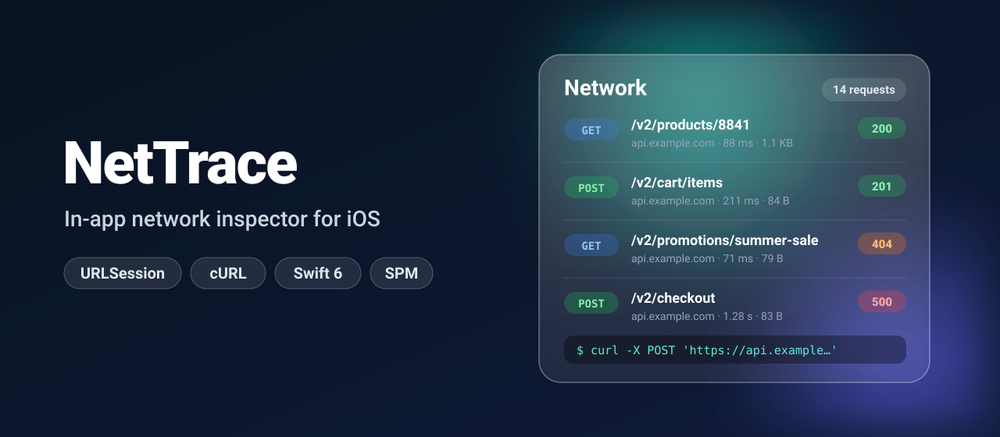
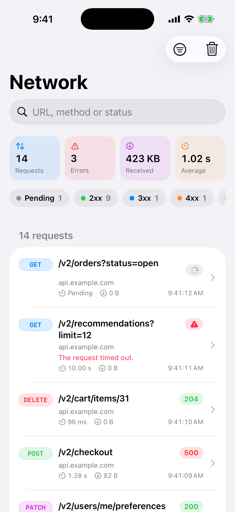
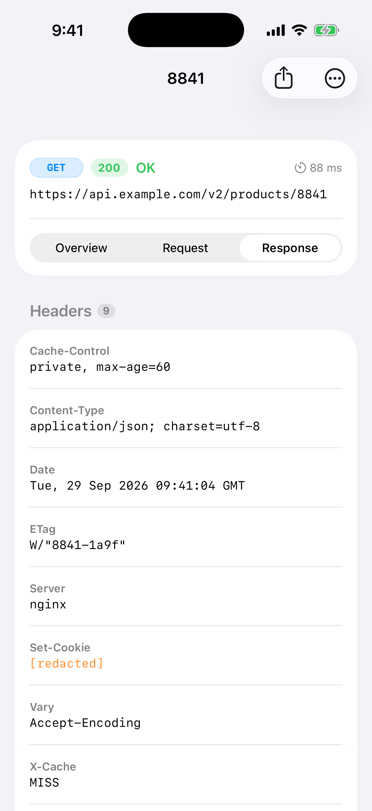
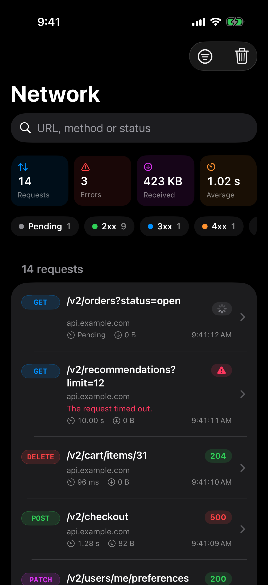
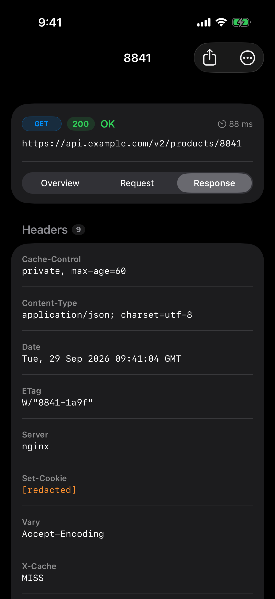

<p align="center">
  
</p>

<p align="center">
  <a href="https://github.com/halilozel1903/NetTrace/actions/workflows/ci.yml"></a>
  
  
  
  
  <a href="LICENSE"></a>
</p>

**NetTrace** shows your app's network traffic inside the app. It records every `URLSession` request with a `URLProtocol`, lists them with method, status, duration and size, and opens each one in a detail screen with the headers, a syntax-highlighted **JSON viewer** and a **cURL** command you can share. Shake the device or tap a floating button to open it. Sensitive headers are redacted before anything is stored. Meant for debug builds.

Two lines:

```swift
NetTrace.enable()          // at launch

ContentView()
    .netTrace(.shake)      // shake to open the inspector
```

## Screenshots

Captured from the example app on an iOS 26 simulator by CI, with fixed sample data.

| | Request list | Response detail |
| :---: | :---: | :---: |
| **Light** |  |  |
| **Dark** |  |  |

## Features

- **Captures URLSession traffic**: `URLSession.shared` after one `NetTrace.enable()`, your own sessions through `NetTrace.configuration()`. Method, URL, headers, bodies, status, timing and errors.
- **Request list** with a colored method badge, status code, host, duration, response size and time. A summary strip counts requests, errors, bytes received and the average time.
- **Search and filters**: search by URL, method, status code or error text; filter by method and by 2xx / 3xx / 4xx / 5xx / failed.
- **Detail screen** with *Overview*, *Request* and *Response* tabs: headers, query parameters, bodies and timing.
- **JSON viewer**: pretty printed with keys in their original order and numbers exactly as sent, syntax highlighted, selectable and copyable.
- **cURL export**: share or copy any request as a `curl` command to repeat it in the terminal.
- **Redaction by default**: `Authorization`, `Proxy-Authorization`, `Cookie` and `Set-Cookie` values are replaced before they reach the store. Add your own header names.
- **Bounded memory**: bodies are cut at 256 KB (the full size is still shown) and the store keeps the last 500 requests. Both are configurable.
- **Shake to open** or a **floating button** with the request count, which uses Liquid Glass on iOS 26.
- **Pure, tested logic**: cURL building, redaction, JSON formatting, filtering and size / duration formatting are covered by Swift Testing.
- **Swift 6 strict concurrency**, `@Observable`, zero dependencies.

## Installation

Add the package in Xcode via **File › Add Package Dependencies…**:

```
https://github.com/halilozel1903/NetTrace
```

or in `Package.swift`:

```swift
dependencies: [
    .package(url: "https://github.com/halilozel1903/NetTrace", from: "1.0.0")
]
```

## Quick start

```swift
import NetTrace
import SwiftUI

@main
struct ShopApp: App {
    init() {
        #if DEBUG
        NetTrace.enable()
        #endif
    }

    var body: some Scene {
        WindowGroup {
            ContentView()
                #if DEBUG
                .netTrace([.shake, .floatingButton])
                #endif
        }
    }
}
```

Run the app, make a few requests, then shake the device (**Device › Shake** in the simulator) or tap the round button.

NetTrace is a debugging tool. Keep both calls inside `#if DEBUG` so release builds neither record traffic nor show the inspector.

## Usage

### Which requests are recorded

`NetTrace.enable()` registers `NetTraceURLProtocol` globally, which covers `URLSession.shared`. A session you create with its own configuration needs the protocol in that configuration:

```swift
let session = URLSession(configuration: NetTrace.configuration())            // .default
let upload = URLSession(configuration: NetTrace.configuration(.ephemeral))

// or, for a configuration you already have:
NetTrace.inject(into: configuration)
```

Only `http` and `https` requests are recorded. Background sessions do not support custom URL protocols, so their transfers are not recorded. WebSocket tasks are skipped.

`NetTrace.disable()` stops recording; `NetTrace.clear()` empties the list.

### Options

```swift
NetTrace.enable(options: NetTraceOptions(
    maxBodySize: 512 * 1024,
    redactedHeaders: Redactor.defaultHeaders.union(["X-Api-Key"]),
    ignoredHosts: ["analytics.example.com"],
    maxRecords: 1000
))
```

| Option | Default | Meaning |
| --- | --- | --- |
| `maxBodySize` | 256 KB | Request and response bodies are cut at this size. The full size is still shown. |
| `redactedHeaders` | `Authorization`, `Proxy-Authorization`, `Cookie`, `Set-Cookie` | Case-insensitive header names whose values become `[redacted]` |
| `ignoredHosts` | none | Hosts that are never recorded. `example.com` also covers `api.example.com`. |
| `maxRecords` | 500 | How many requests are kept; the oldest go first |

`NetTrace.options` can also be changed later; new values apply to requests that start afterwards.

### Opening the inspector

```swift
.netTrace(.shake)                      // shake gesture (iOS)
.netTrace(.floatingButton)             // round button in the bottom trailing corner
.netTrace(.all)                        // both
.netTrace(isPresented: $showsNetwork)  // your own trigger, for example a debug menu
```

`NetTraceView` is a regular view with its own `NavigationStack`, so it can also live in a tab of a debug build or in a sheet you present yourself:

```swift
TabView {
    ShopView().tabItem { Label("Shop", systemImage: "bag") }
    NetTraceView().tabItem { Label("Network", systemImage: "network") }
}
```

### cURL, JSON and the other building blocks

The pieces the UI uses are public and have no side effects:

```swift
CURLBuilder.command(for: record)
// curl -X POST 'https://api.example.com/v2/cart/items' \
//   -H 'Accept: application/json' \
//   -H 'Content-Type: application/json' \
//   --data-raw '{"productId":8841,"quantity":1}'

JSONFormatter.prettyPrinted(data)          // String?, keeps key order and number spelling
Redactor().redact(headers)                 // [String: String]
RecordFilter(searchText: "cart 500", methods: ["POST"]).apply(to: records)
NetTraceFormat.byteCount(18_841)           // "18 KB"
NetTraceFormat.duration(0.084)             // "84 ms"
```

A body that was cut or is binary is left out of the cURL command, with a comment line saying so.

### Your own store

`NetTraceStore` is thread-safe and can be filled by hand, which is handy for previews and screenshots:

```swift
let store = NetTraceStore(records: [
    NetworkRecord(method: "GET", url: URL(string: "https://api.example.com/v2/products")!,
                  endDate: .now, statusCode: 200)
])

NetTraceView(store: store)
```

`NetTraceInspector` is the `@Observable` model behind the list, for building a UI of your own.

## How it works

`NetTraceURLProtocol` claims each new HTTP(S) request, adds a record to the store, and sends a tagged copy of the request through its own `URLSession`. The tag keeps the copy from being claimed again. Response data is passed to the original task as it arrives and collected, up to the size limit, for the record. Redirects, authentication challenges and caching keep URLSession's default behavior.

A request body set with `httpBody` usually reaches a URL protocol as a stream. NetTrace reads that stream once and forwards the bytes, so the server receives the same body.

| | iOS 26 / macOS 26 | iOS 17 – 18 / macOS 14 – 15 |
| --- | --- | --- |
| Floating button | Interactive `glassEffect` | `.regularMaterial` |
| Shake to open | Yes (iOS) | Yes (iOS) |
| Inspector | Sheet on iOS, sheet with a minimum size on macOS | Same |

## Example app

The `Example` folder contains *NetTrace Demo* with buttons that send real requests (a JSON post, a 404, a 500, a slow response, an image) and a button that adds sample requests without a network. It uses [XcodeGen](https://github.com/yonaskolb/XcodeGen) so no project file has to live in the repo:

```bash
brew install xcodegen
cd Example && xcodegen generate
open NetTraceDemo.xcodeproj
```

## Requirements

- Xcode 26 or later (Swift 6.2 toolchain)
- iOS 17+ / macOS 14+ (Liquid Glass automatically on 26+)

## Contributing

Issues and pull requests are welcome. Please run `swift test` before opening a PR.

## License

NetTrace is available under the MIT license. See [LICENSE](LICENSE).
